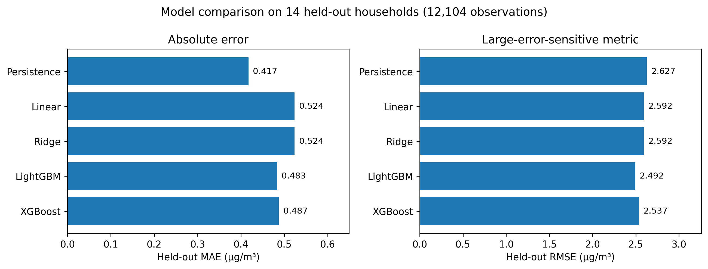
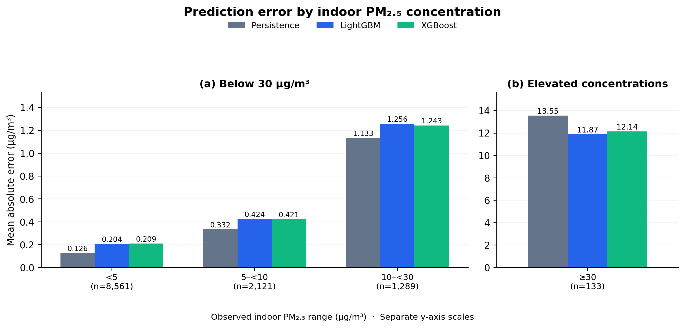
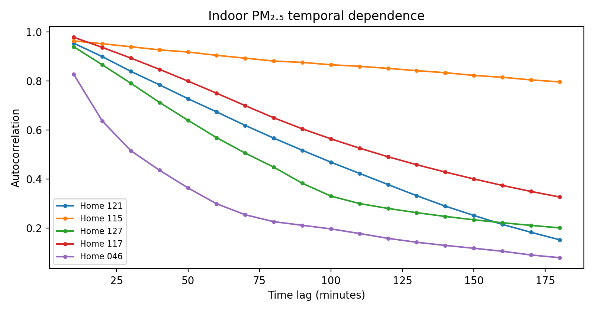

<div align="center">

# 🏠🌿 Indoor PM₂.₅ Prediction with Machine Learning
### CHE1147 · Chemical Data Science and Engineering · University of Toronto
**Team 4 · Fall 2026**


**[🔎 Overview](#-project-overview)** · **[🗂 Repository map](#-repository-map)** · **[🧪 Two experiments](#-two-modeling-workflows)** · **[📊 Results](#-second-model-results)** · **[⚙️ Setup](#%EF%B8%8F-setup--run)**

</div>

---

## 🔎 Project overview

We explore whether supervised regression and gradient-boosted trees can predict **next-interval indoor PM₂.₅ concentrations** in residential homes, compared with a simple persistence baseline. The project uses measurements from the LBNL California residential indoor-air-quality dataset and explores changes over **10-minute intervals**.

> **Research question:** Can machine-learning models improve next-interval indoor PM₂.₅ prediction when evaluated in residential buildings excluded from training?

The repository now contains **two clearly separated workflows**: the original team code, retained without edits, and a **Second Model** folder holding the revised analysis, numerical results, figures, and an HTML summary.

## 🗂 Repository map

| Location | What is inside? |
|---|---|
| 🧑‍💻 **[`main.ipynb`](main.ipynb)** | Frank / team original Jupyter notebook — unchanged |
| 🐍 **[`config.py`](config.py), [`pipeline.py`](pipeline.py)** | Original Python configuration and pipeline — unchanged |
| 🧩 **[`data_loader.py`](data_loader.py), [`feature_engineering.py`](feature_engineering.py)** | Original loading and feature scripts — unchanged |
| 🧪 **[`cross_validation.py`](cross_validation.py), [`nested_cv.py`](nested_cv.py)** | Original team cross-validation experiments — unchanged |
| 🎯 **[`tune_lightgbm.py`](tune_lightgbm.py), [`tune_xgboost.py`](tune_xgboost.py)** | Original hyperparameter-tuning scripts — unchanged |
| 🗃️ **[`DATA/`](DATA/)** | **All original raw monitoring files, preserved** |
| ✨ **[`Second_Model/`](Second_Model/)** | **Revised / paper-aligned experiment** and its results |
| 📓 **[Second Model executed notebook](Second_Model/Second_Model_Executed.ipynb)** | Saved outputs included |
| 📈 **[Second Model HTML results](Second_Model/results_dashboard.html)** | Self-contained HTML dashboard — download and open locally |
| 🖼️ **[`assets/figures/`](assets/figures/)** | Research figures shown on this README |
| 📚 **[`docs/`](docs/)** | Data, validation, workflow comparison, and figure guide |

### 🧭 Quick links

| I want to… | Open |
|---|---|
| Run the **original team notebook** | [`main.ipynb`](main.ipynb) |
| Examine the **second experiment** | [`Second_Model/README.md`](Second_Model/README.md) |
| Review **executed notebook results** | [`Second_Model_Executed.ipynb`](Second_Model/Second_Model_Executed.ipynb) |
| Download the **standalone HTML results** | [`results_dashboard.html`](Second_Model/results_dashboard.html) |
| View **model metrics** | [`model_metrics.csv`](Second_Model/results/model_metrics.csv) |
| Review **raw household monitoring data** | [`DATA/`](DATA/) |
| Understand why the methods differ | [`docs/EXPERIMENTS.md`](docs/EXPERIMENTS.md) |

---

## 🧪 Two modeling workflows

| | Original Team Exploration | ✨ Second Model — paper-aligned |
|---|---|---|
| Code entry | `main.ipynb` and root `.py` files | `Second_Model/Second_Model_Executed.ipynb` |
| Split | Original seed 42 | 54 development / 14 held-out households; seed 2026 |
| Features | Original medium selection | 35 selected predictors |
| Tuning | Exploratory Optuna / cross-validation scripts | Five-fold grouped CV and randomized search |
| Persistence benchmark | Not in original four-model comparison | Explicit baseline and selection benchmark |
| Saved output | Original notebook | CSV metrics, figures, HTML results dashboard |

> [!IMPORTANT]
> These workflows use different data preparation, predictors, household partitions, and tuning methods. **Their scores should not be directly mixed into one comparison**. Original scripts were kept intact for transparency, and the Second Model is labeled separately.

---

## 📌 Second Model — at a glance

| Study attribute | Value |
|---|---:|
| Source households | 70 |
| Eligible households | **68** |
| 10-minute observations | **62,794** |
| Development / held-out households | **54 / 14** |
| Development / held-out observations | **50,690 / 12,104** |
| Predictors | **35** |
| Evaluation | Five-fold grouped CV + household hold-out |

## 📊 Second Model results

**Held-out evaluation: 14 households, 12,104 target intervals.** MAE and RMSE are in µg/m³. ↓ = lower is better; ↑ = higher is better.

| Model | CV MAE ↓ | Test MAE ↓ | Test RMSE ↓ | Test R² ↑ |
|:---|---:|---:|---:|---:|
| **Persistence** | **0.5894** | **0.4173** | 2.6269 | 0.8712 |
| Linear regression | 0.6946 | 0.5237 | 2.5918 | 0.8746 |
| Ridge regression | 0.6946 | 0.5237 | 2.5918 | 0.8746 |
| **LightGBM** | 0.6677 | 0.4832 | **2.4921** | **0.8840** |
| XGBoost | 0.6858 | 0.4871 | 2.5373 | 0.8798 |

**Interpretation:** Persistence achieved the lowest overall MAE, while LightGBM achieved the lowest RMSE and R². See the [HTML results dashboard](Second_Model/results_dashboard.html) and [Second Model documentation](Second_Model/README.md) for the experiment details.

### 📉 Comparing models



### 🌡️ Error by observed concentration



### 🔄 Temporal autocorrelation



### 🔬 More figures

| Correlations and target | Feature importance |
|---|---|
| [Predictor correlation heatmap](assets/figures/correlation_heatmap.png) | [LightGBM importance](assets/figures/lightgbm_importance.png) |
| [Indoor PM₂.₅ distribution](assets/figures/target_distribution.png) | [XGBoost importance](assets/figures/xgboost_importance.png) |

---

## ⚙️ Setup & run

### 1. Obtain the repository

Use GitHub Desktop to clone the repository, or run:

```bash
git clone https://github.com/YOUR_GITHUB_USERNAME/CHE1147-Indoor-PM25-ML.git
cd CHE1147-Indoor-PM25-ML
```

Replace `YOUR_GITHUB_USERNAME` with the account that owns your new test repository.

### 2. Install dependencies

Use a dedicated Python 3.11 environment. For the Second Model:

```bash
python3 -m venv .venv
source .venv/bin/activate
python -m pip install --upgrade pip
python -m pip install -r requirements-paper.in
jupyter lab
```

If XGBoost reports an OpenMP runtime issue on macOS, refer to the [XGBoost installation documentation](https://xgboost.readthedocs.io/en/stable/install.html).

### 3. Locate the raw monitoring dataset

The repository includes the team's original [`DATA/`](DATA/) folder. The full dataset is described by the [original Dryad record](https://doi.org/10.7941/D1ZS7X). Before making the repository public, verify permission to redistribute the research data.

### 4. Run either workflow

- **Original analysis:** open [`main.ipynb`](main.ipynb). The original [`config.py`](config.py) looks for a local `DATA/` folder.
- **Second Model:** open [`Second_Model/Second_Model_Clean.ipynb`](Second_Model/Second_Model_Clean.ipynb). In the first setup cell, set `USER_DATA_ROOT` to the absolute path of this repository's `DATA` folder (or your own local data path).

The **standalone HTML dashboard** shows the previously saved results without rerunning models. GitHub's source file preview does not display the HTML as a live web page; download and open it locally, or serve with GitHub Pages if permitted.

---

## 📖 Notes on interpretation

The Second Model predicts **the next 10-minute interval**. The indoor PM₂.₅ target is capped at **100 µg/m³**. 

More details: [Experiment guide](docs/EXPERIMENTS.md) · [Methodology guide](docs/METHODOLOGY.md) · [Figure guide](docs/FIGURES.md).

---

## 👥 Team

**Dante Flores · Frank Li · Yazan Zamel**

CHE1147 — Chemical Data Science and Engineering, University of Toronto  
Course instructor: Seyed Mohamad Moosavi

## 📚 References

- [Singer et al. (2020), *Indoor air quality in California homes with code-required mechanical ventilation*](https://doi.org/10.1111/ina.12676)
- [Original research dataset at Dryad](https://doi.org/10.7941/D1ZS7X)
- [Ke et al. (2017), LightGBM](https://papers.neurips.cc/paper/2017/hash/6449f44a102fde848669bdd9eb6b76fa-Abstract.html)
- [Chen & Guestrin (2016), XGBoost](https://doi.org/10.1145/2939672.2939785)
- [CHE1147 course repository](https://github.com/AI4ChemS/CHE1147)

## 💬 Feedback

Suggestions and bug reports can be submitted via the GitHub repository's **Issues** tab.

---

<div align="center"><sub>CHE1147 · Team 4 · Fall 2026 · Research/teaching project, not an operational air-quality warning service.</sub></div>
